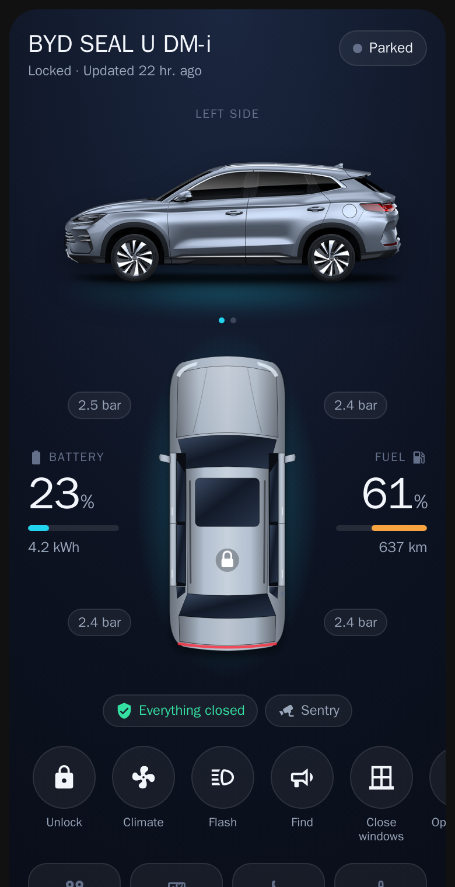
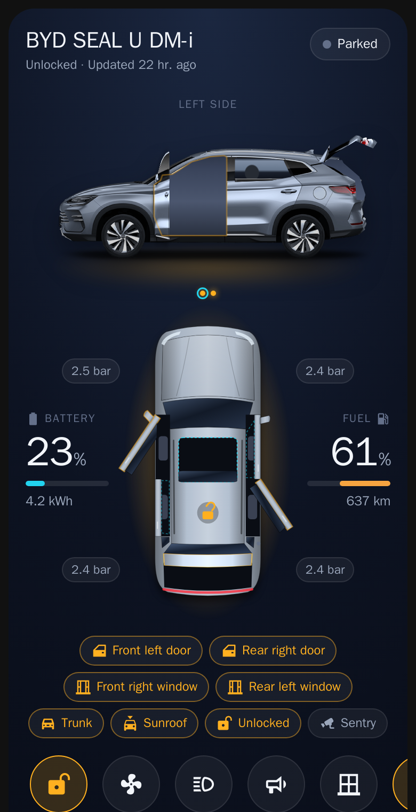
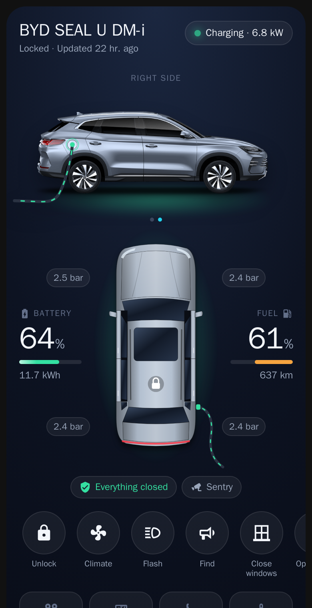
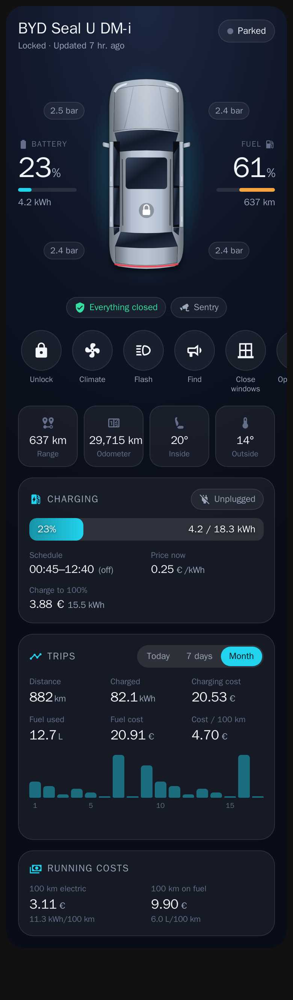
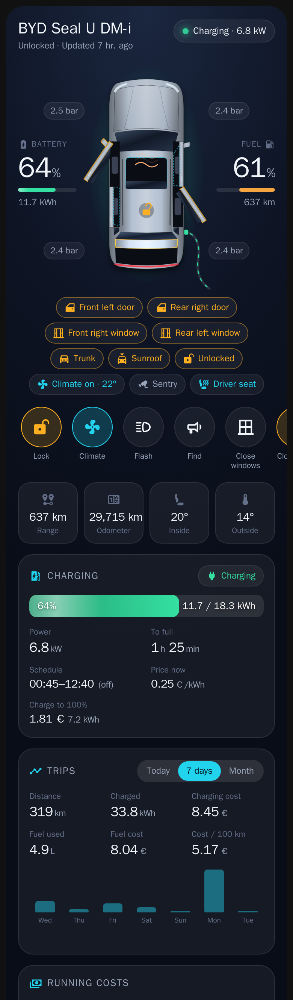
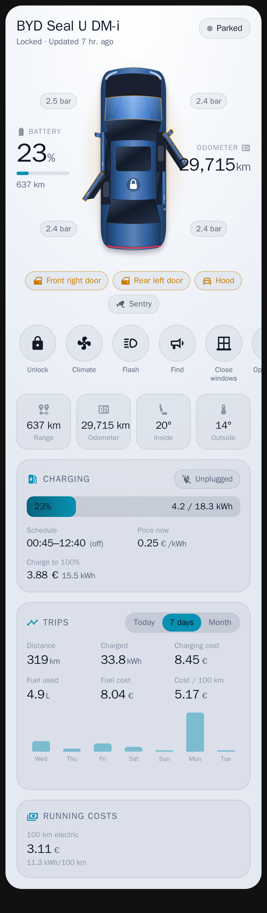

# BYD Vehicle Card

An animated Lovelace card for Home Assistant and the
[hass-byd-vehicle](https://github.com/jkaberg/hass-byd-vehicle) integration.
One file, no dependencies, built for phones.

| Real car, parked | Doors and windows open | Charging |
|---|---|---|
|  |  |  |

| Drawing only | Doors / charging | Light theme |
|---|---|---|
|  |  |  |

## What it shows

- **Animated car** – doors, windows, hood, trunk, sunroof, lock, climate airflow,
  charging cable, driving. Three body styles (`suv`, `sedan`, `hatchback`), any paint colour.
- **Your real car, animated (optional)** – give the card the official side render of
  your car and its doors, windows, hood and tailgate open on the photo, wheels spin
  while driving, the cable plugs in while charging. Optional interior photos appear
  behind open doors.
- Battery, fuel (PHEV), range, odometer, temperatures, tyre pressures.
- **Hold-to-activate buttons** – lock, climate, flash lights, find car, close windows,
  trunk, refresh. A short tap never sends a command.
- **Charging** – power, time to full, schedule, price now (fixed or from a dynamic
  tariff sensor, rated cheap / normal / expensive), cost of charging to 100 %.
- **Trips** – Today / 7 days / Month: distance, energy charged, charging cost, fuel
  used, fuel cost, cost per 100 km, daily bar chart. Calculated by the card from
  Home Assistant history – no helpers needed.
- Running cost per 100 km on electricity vs. fuel, warnings, map, your own extra entities.
- English, Polish, German. Dark / light / auto. Visual editor.

Entities are found automatically from the integration's device. Nothing to map by hand.

## Install

**HACS:** HACS → ⋮ → Custom repositories → add this repository as *Dashboard* → install.

**Manual:** copy `byd-vehicle-card.js` to `/config/www/` and add
`/local/byd-vehicle-card.js` as a *JavaScript module* in
Settings → Dashboards → ⋮ → Resources.

## Use

```yaml
type: custom:byd-vehicle-card
body_style: suv            # suv | sedan | hatchback
car_color: boundless-cloud # name (white, black, grey, silver, blue, red, green, boundless-cloud…) or hex
battery_capacity: 18.3     # kWh – enables energy and cost figures
price_entity: sensor.electricity_price   # dynamic tariff, per kWh
# price_fixed: 0.25        # …or a fixed price
currency: €
fuel_tank: 60              # litres (PHEV)
fuel_price: 1.65
```

### Options

| Option | Default | Description |
|---|---|---|
| `device` | first BYD vehicle | Device id, when you have more than one car |
| `name` | device name | Title |
| `body_style` | `suv` | Drawing: `suv`, `sedan`, `hatchback` |
| `car_color` | `grey` | Paint name or any CSS colour |
| `charge_port` | `rear_right` | `rear_right`, `rear_left`, `front_right`, `front_left` |
| `appearance` | `dark` | `dark`, `light`, `auto` |
| `battery_capacity` | – | kWh. Needed for energy / cost |
| `charging_loss` | `10` | Charger losses in %, added to energy and cost |
| `price_fixed` / `price_entity` | – | Price per kWh: a number or a sensor |
| `fuel_tank`, `fuel_price` / `fuel_price_entity`, `fuel_consumption` | – | PHEV fuel figures |
| `currency` | from price sensor | Currency label |
| `actions` | all available | Buttons to show: `lock`, `climate`, `flash_lights`, `find_car`, `close_windows`, `open_windows`, `trunk`, `start_charging`, `force_poll` |
| `hold_time` | `900` | Milliseconds a button must be held |
| `pressure_unit`, `tire_low` | `bar`, `2.0` | Tyre pressure unit and warning threshold (bar) |
| `ignore_warnings` | `[pwr]` | Warning keys to hide |
| `show_map` | `true` | Map with the car's position |
| `extra_entities`, `extra_title` | – | Any entities to list at the bottom (tap opens more-info) |
| `power_entity` | – | Your own charging-power sensor (W or kW) |
| `stats` | – | Your own sensors instead of calculated values: `distance_today`, `distance_month`, `energy_*`, `cost_*`, `fuel_*`, `fuel_cost_*` |
| `entities` | – | Override any auto-detected entity: `{ lock: lock.my_car }` |
| `side_photo`, `side_model` | –, `seal_u` | Animated real photo, see below |
| `interior_front`, `interior_rear` | – | Photo shown behind open doors: URL or `{ url, flip, position }` |
| `photos` | – | Extra still photos; tap the picture to cycle |
| `demo` | `false` | Cycle through all animations without touching the car |

### Your real car, animated

The repository includes BYD's official renders of a **Seal U DM-i in Boundless Cloud**
(`images/seal-u-side.png`, `images/seal-u-front.png`). Copy them to `/config/www/` and:

```yaml
side_photo: /local/seal-u-side.png
side_model: seal_u
photos: [/local/seal-u-front.png]               # optional extra view, tap to switch
interior_front: /local/my-interior-front.jpg   # optional, your own photo
interior_rear: /local/my-interior-rear.jpg     # optional, your own photo
```

**Your own car in your colour.** BYD's cloud holds the same kind of transparent render
for every car – the picture the BYD app shows.

1. Enable debug logging for `pybyd` and reload the integration. Search the log for
   `picMainUrl` (side, 1050×420 PNG) and `picSetUrl` (front three-quarter view) and open
   those addresses.
2. Save them to `/config/www/` and point `side_photo` / `photos` at them.

The picture shows the left side; the right side is its mirror image. Tap to switch
sides – the card also switches by itself to the side where something opens.

`side_model` holds the outlines of doors, windows, hood, tailgate and wheels in image
pixels. Only **Seal U** is built in so far. For another model pass your own object with
the same shape as `SIDE_MODELS.seal_u` in the source – and please send a pull request.

### About the BYD images

The car renders in `images/` (and the car shown in the `docs/photo-*.png` screenshots) are
the property of BYD Company Ltd. They are the pictures BYD's own cloud serves to the owner
of the car, included here only to show how the card works. This project is not
affiliated with, endorsed by or sponsored by BYD, and the MIT license of this repository
does **not** cover these images. BYD and the model names are trademarks of BYD Company
Ltd. If you are a rights holder and want them removed, please open an issue and they
will be taken down.

## Notes

- Energy and cost are estimated from battery-level changes × `battery_capacity`, so they
  are approximate. Use `stats` to plug in your own meters.
- Tested on a BYD Seal U DM-i. Other models should work wherever the integration
  provides the entities; missing ones are simply hidden.

MIT License (code only – see *About the BYD images*). Not affiliated with BYD.
